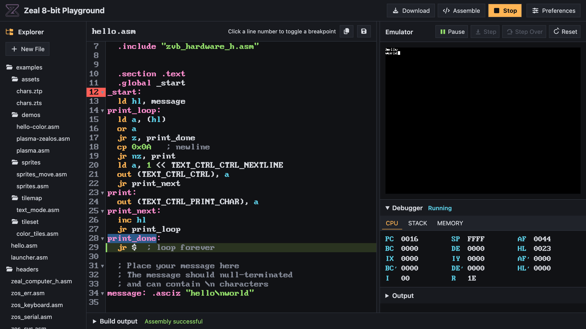

# Zeal Playground

[Open Zeal Playground](https://zeal8bit.github.io/Zeal-Playground/)

## Stepping through an example

Open `examples/sprites/sprites.asm` and click the line number beside the first `call memset`.
Click **Run**. The launcher sets up the machine, then execution pauses at your breakpoint.
**Step** enters `memset` in `zeal_computer_h.asm`. **Step Over** on the call runs the routine and pauses back in `sprites.asm`.

To see startup itself, enable **Preferences → Start paused** before running. The editor shows the instruction about to execute, starting in `launcher.asm`. Use the source buttons above the code to look around while paused. Included files show the read-only source used for that build. **Stop** returns to your editable example.

## Zeal Native Emulator

Zeal Playground uses the new [Zeal Native Emulator](https://github.com/Zeal8bit/Zeal-NativeEmulator), compiled for WASM using Emscripten.

## CodeMirror

Zeal Playground uses [CodeMirror](https://codemirror.net/) for it's text editor.

## GNU Assembler

Zeal Playground uses GNU AS, LD, OBJCOPY for Z80 for its assembler.
